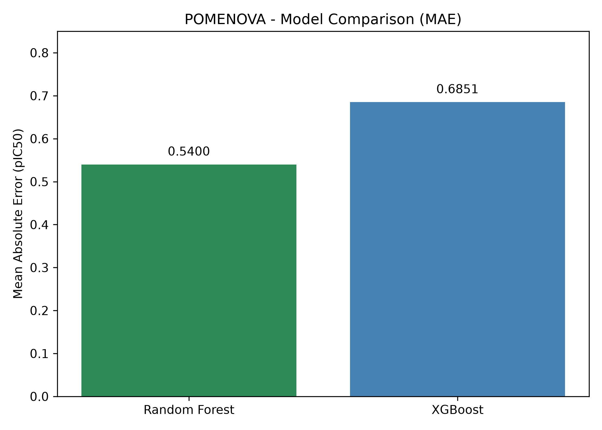
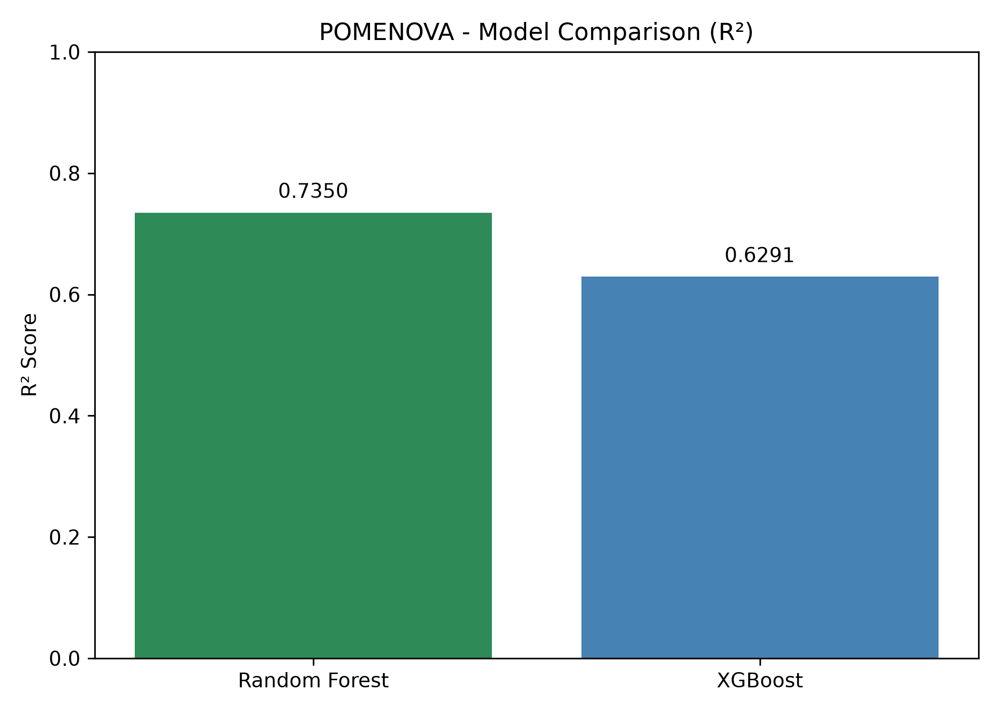
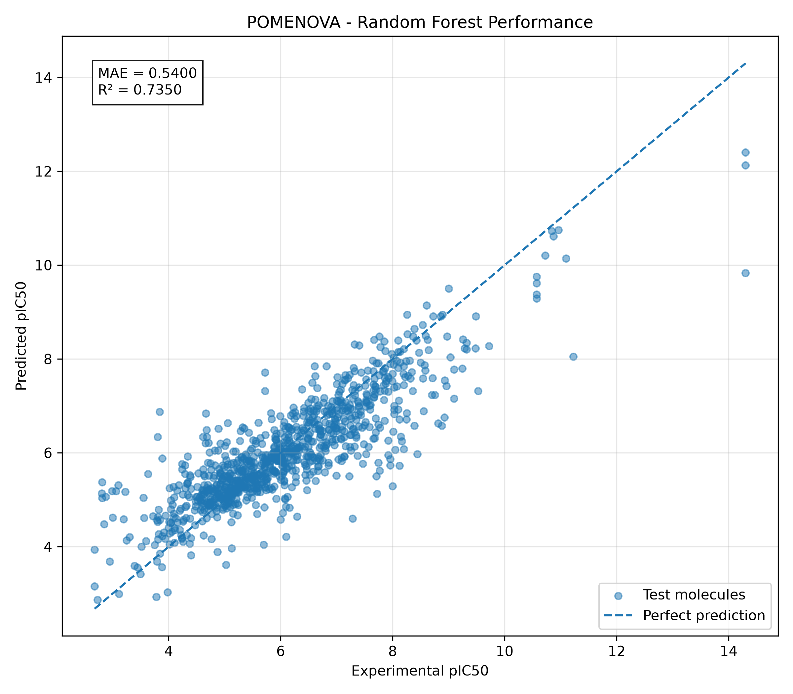
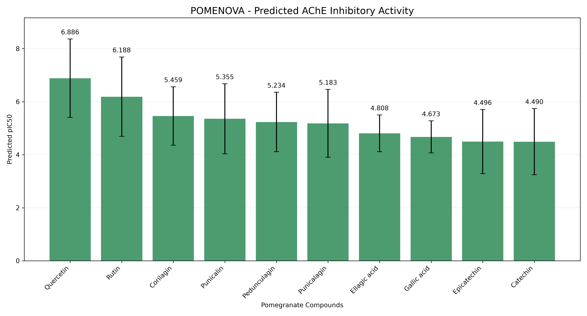

# 🍎 POMENOVA — Nature Meets Intelligence

### EthnoHack 2026 | AI-Assisted Drug Discovery

POMENOVA is an interactive scientific research platform exploring pomegranate-associated phytochemicals and their predicted activity against human acetylcholinesterase (AChE).

The project combines natural-product research, cheminformatics, machine learning, and scientific validation.

## Scientific Objective

Our goal is to prioritize selected pomegranate phytochemicals for further investigation as potential AChE inhibitors using computational methods.

**Target:** Human acetylcholinesterase (CHEMBL220)

**Botanical source:** Punica granatum L.

## Technologies

- Python and Streamlit
- RDKit for molecular descriptors and fingerprints
- ChEMBL for AChE bioactivity data
- PubChem for molecular structures
- Scikit-learn and XGBoost for machine learning
- Pandas, NumPy and Altair for data analysis

## Machine Learning Results

| Model | MAE (pIC50) | R² |
|---|---:|---:|
| Random Forest | 0.5400 | 0.7350 |
| XGBoost | 0.6851 | 0.6291 |

### Model Comparison — MAE



### Model Comparison — R²



### Actual vs Predicted pIC50



### Pomegranate Compound Ranking



## Scaffold-Based Validation

| Model | MAE (pIC50) | R² |
|---|---:|---:|
| Random Forest | 0.5935 | 0.6777 |
| XGBoost | 0.7013 | 0.5924 |

Scaffold-based evaluation helps assess model generalization to different molecular frameworks.

## Web Application

POMENOVA includes nine interactive sections:

1. Discover POMENOVA
2. Compound Library
3. Molecular Explorer
4. AI Activity Predictor
5. Model Validation
6. Biological Target
7. Scientific Evidence
8. Research Workflow
9. Impact & Next Steps

## Run Locally

Install dependencies:

```bash
pip install -r requirements.txt
```

Launch the application:

```bash
python -m streamlit run app.py
```

## Scientific Limitations

Predicted pIC50 values are computational estimates, not experimental confirmation of AChE inhibition.

Further biochemical assays, selectivity studies, ADMET evaluation, and biological validation are required.

POMENOVA does not establish that pomegranate compounds prevent or treat Alzheimer's disease.

---

**POMENOVA — Nature Meets Intelligence**

EthnoHack 2026 | Early-Stage Drug Discovery Research
## 🎬 POMENOVA — Demo Video

Watch our official EthnoHack 2026 presentation and application demonstration:

[Watch POMENOVA on YouTube](https://youtu.be/VS-VCY0mWig?si=gurn5kF883kK-j6Z)

## 🌐 Live Application — POMENOVA

Explore our interactive AI-powered drug discovery platform.

[🍎 Launch POMENOVA Application](https://youtu.be/VS-VCY0mWig?si=gurn5kF883kK-j6Z)

Discover natural compounds, explore molecular structures,
predict AChE inhibitory activity, and review model validation.

